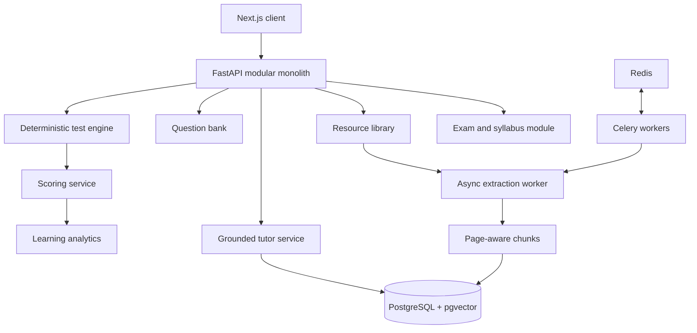

# PrepOS — Architecture

## Logical flow

## Module boundaries
- `users`: identity, sessions and authorization.
- `exams`: exam structures and marking schemes.
- `syllabus`: subjects, topics and progress.
- `resources`: upload, metadata, extraction and provenance.
- `retrieval`: chunking, embeddings and authorized retrieval.
- `tutor`: grounded answer generation and citations.
- `questions`: question bank, answer keys and provenance.
- `assessments`: test definitions, attempts, timing and deterministic scoring.
- `learning`: planner, revision queue and adaptive recommendations.
- `analytics`: aggregations and learner-facing performance metrics.

## Non-negotiable rules
- Objective scoring must not call an LLM.
- The server is authoritative for test timing and submitted answers.
- Retrieval must enforce user/resource authorization.
- AI answers cite the actual retrieved source chunks.
- AI-generated questions remain drafts until reviewed/approved.
- Start modular monolith; extract services only when operational evidence justifies it.
